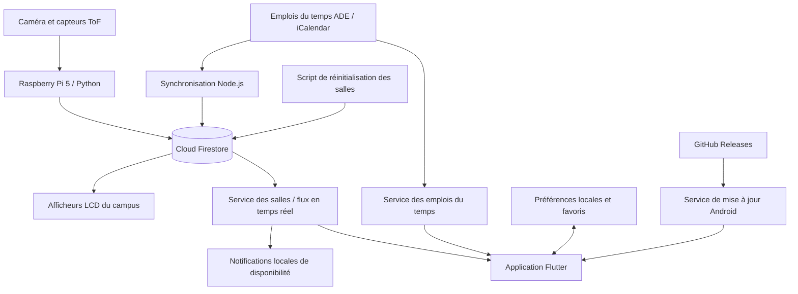

<p align="center">
  
</p>

<h1 align="center">ClassroomTracker</h1>

<p align="center">
  
  
  
  
</p>

<p align="center">
  Application développée par <a href="https://github.com/Temiyoko">Julia LEVEQUE</a> et <a href="https://github.com/justfreezo">Paulo MARTINS</a>.
  <br />
  Projet E3 · ESIEE Paris · Journée des Projets 2026
</p>

## Présentation

ClassroomTracker s’inscrit dans un projet de première année du cycle ingénieur (E3) à **ESIEE Paris**, réalisé dans le cadre de la **Journée des Projets 2026**. Le projet global associe un dispositif de détection et de comptage des occupants à une application mobile et à des afficheurs sur le campus. Ce dépôt concerne principalement l’application mobile et ses services associés.

ClassroomTracker est une application mobile conçue pour aider les étudiants à trouver des salles de classe, des laboratoires et des amphithéâtres disponibles au sein d'ESIEE Paris. Elle combine les données d'occupation stockées dans Cloud Firestore avec les emplois du temps du système ADE de l'Université Gustave Eiffel.

Que ce soit pour réviser au calme, travailler en groupe ou patienter entre deux cours, ClassroomTracker permet de repérer les espaces disponibles sans avoir à parcourir les couloirs à la recherche d'une salle libre.

## Journée des Projets — Poster 2026

<p align="center">
  
</p>

Le poster présente le dispositif global : caméra et capteurs ToF, traitement Python sur Raspberry Pi 5, stockage des mesures dans Firebase et affichage de la disponibilité des salles dans l’application et sur des écrans LCD. Il annonce 96 salles répertoriées et une actualisation des mesures régulières.

## Fonctionnalités

| Fonctionnalité | Description |
| --- | --- |
| Tableau de bord | Visualisation du taux d'occupation global, des salles libres et des salles en cours, par épi et par étage. |
| Données en temps réel | Actualisation de l'état des salles grâce aux flux de données Firestore. |
| Recherche et filtres | Recherche par nom de salle et filtrage par disponibilité, type, étage et épi. |
| Informations détaillées | Consultation de l'occupation, de l'emplacement, du cours en cours et du prochain cours lorsque ces informations sont disponibles. |
| Favoris | Enregistrement local des salles favorites pour un accès rapide. |
| Notifications | Alertes locales lorsqu'une salle favorite se libère, pendant que l'application observe les changements d'état. |
| Personnalisation | Thèmes clair et sombre et personnalisation de la palette de couleurs. |
| Mises à jour intégrées | Vérification des nouvelles versions sur GitHub Releases et téléchargement des mises à jour APK sur Android. |

Une salle est considérée comme libre lorsque son nombre d'occupants enregistré est nul et qu'aucun cours n'y est en cours. La disponibilité dépend de l'exactitude et de l'actualisation des données : elle ne constitue ni une réservation ni une garantie d'accès physique.

## Téléchargement

Consultez la page des [versions publiées](https://github.com/Temiyoko/ClassroomTracker/releases/latest) pour télécharger la dernière version.

- **Android :** téléchargez `ClassroomTracker.apk` et ouvrez-le sur votre appareil. Android peut demander l'autorisation d'installer des applications depuis cette source.
- **iOS :** un fichier IPA est également fourni dans la version publiée. Son installation nécessite une méthode de signature, de provisionnement ou de distribution compatible.

L'application intègre un mécanisme de mise à jour OTA pour Android. L'installation reste soumise aux autorisations du système et aux exigences de signature des applications.

## Technologies utilisées

| Composant | Technologies |
| --- | --- |
| Application | Flutter, Dart, Material 3 |
| Gestion d'état | Provider, ChangeNotifier |
| Données cloud | Firebase Core, Cloud Firestore |
| Emplois du temps | ADE, HTTP, iCalendar |
| Stockage local et notifications | Path Provider, Flutter Local Notifications |
| Scripts de maintenance | Node.js, Firebase Admin SDK, node-ical |
| Automatisation et distribution | GitHub Actions, GitHub Releases, OTA Update |

## Architecture



Les éléments matériels du diagramme correspondent au projet global présenté sur le poster ; leur implémentation n’est pas documentée par le code de ce dépôt.

Le script de synchronisation met à jour l'état des cours et l'heure de début des prochains cours dans Firestore. L'application s'abonne aux changements d'état des salles et récupère séparément les détails des cours auprès du service d'emploi du temps lorsque nécessaire. Les favoris, les paramètres d'apparence et l'historique des notifications sont conservés localement.

## Modèle de données Firestore

Les documents des salles sont stockés dans la collection `classroom`. L'identifiant du document correspond au nom ou au numéro de la salle.

| Champ | Type | Description |
| --- | --- | --- |
| `floor` | Entier | Numéro d'étage |
| `corridor` | Entier | Identifiant de l'épi (`0` correspond à la rue) |
| `type` | Chaîne | `classroom`, `laboratory` ou `amphitheater` |
| `currentPeople` | Entier | Nombre d'occupants enregistré |
| `hasCourse` | Booléen | Indique si un cours est en cours |
| `currentCourse` | Chaîne / null | Nom facultatif du cours en cours |
| `icalResourceId` | Chaîne / null | Identifiant de la ressource ADE |
| `nextCourseStart` | Timestamp / null | Début du prochain cours ; le client accepte également une date ISO |

## Workflows de maintenance

Le dépôt fournit deux workflows GitHub Actions à déclenchement manuel :

| Workflow | Rôle |
| --- | --- |
| Sync Timetable | Récupère les données iCalendar et actualise `hasCourse` et `nextCourseStart`. |
| Reset Classrooms | Réinitialise `currentPeople` à zéro et `hasCourse` à false. |

## Structure du projet

```text
ClassroomTracker/
├── lib/
│   ├── main.dart              # Point d'entrée et navigation
│   ├── firebase_options.dart  # Configuration Firebase
│   ├── models/                # Modèles des salles, cours et notifications
│   ├── screens/               # Accueil, liste des salles et paramètres
│   ├── services/              # Données, emplois du temps, alertes, thèmes et mises à jour
│   └── widgets/               # Interface de détail des salles
├── scripts/                   # Scripts de maintenance Firebase et ADE
├── .github/workflows/         # Workflows GitHub Actions
├── android/                   # Projet Android
├── ios/                       # Projet iOS
├── test/                      # Test de widget Flutter
└── pubspec.yaml               # Dépendances et métadonnées
```

## Auteurs originaux et contributions

L’application mobile ClassroomTracker a été initialement conçue et développée par **Julia LEVEQUE** et **Paulo MARTINS**.

| Auteur original | Contributions |
| --- | --- |
| **[Julia LEVEQUE](https://github.com/Temiyoko)** | Co-autrice — développement et implémentation de l'application. |
| **[Paulo MARTINS](https://github.com/justfreezo)** | Co-auteur — conception UI/UX, identité visuelle et amélioration de l'interface utilisateur. |

Cette section reconnaît le travail de l'équipe de développement initiale, y compris les contributions réalisées en collaboration directe qui ne sont pas individuellement représentées dans l'historique des commits Git. Le statut de collaborateur du dépôt et le nombre de commits ne reflètent pas nécessairement l'ensemble du travail de conception et de développement effectué.

### Équipe du projet E3

Le poster de la Journée des Projets identifie l’équipe du projet global : Julia LEVEQUE, Paulo MARTINS, Titouan FOURNEAU, Lisa BOULARD, Zoé CARRUETTE et Manon CIPCIC. Encadrante : Fatima AZIZ. Cette liste concerne le projet dans son ensemble, distinct de l’attribution du développement de l’application mobile ci-dessus.
